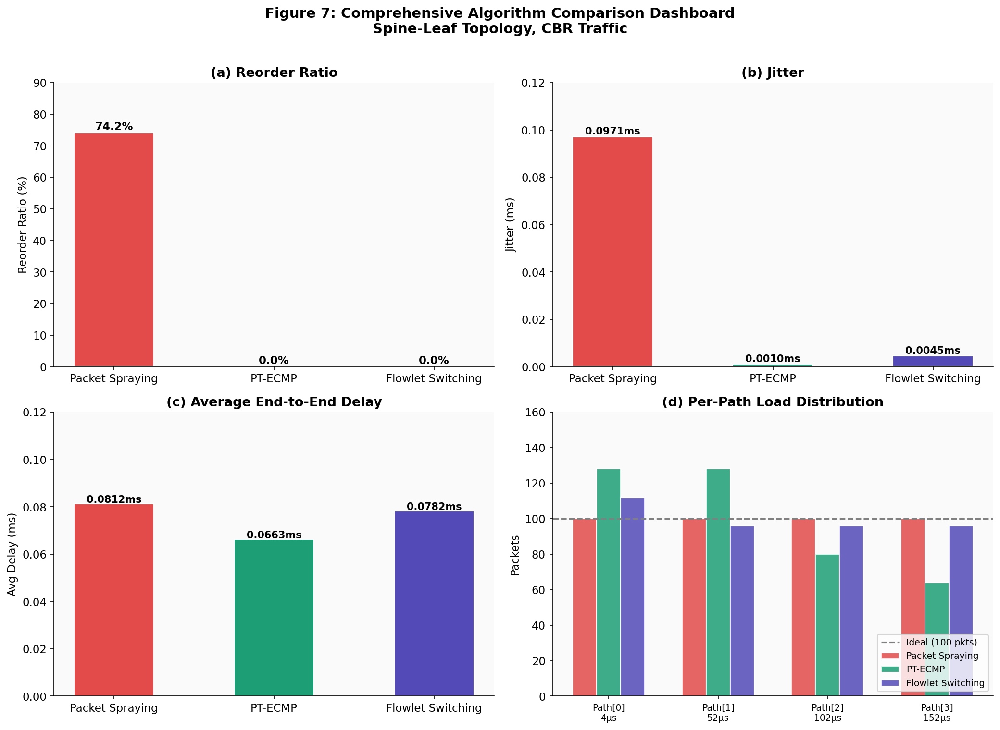
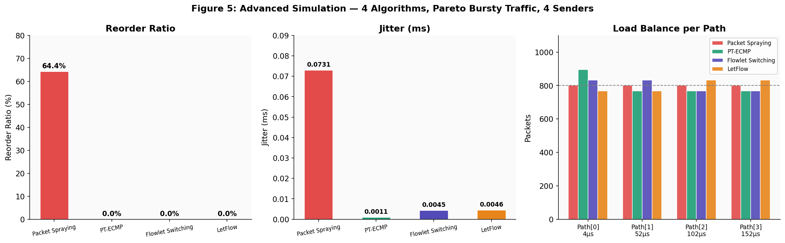

# Packet Spraying Optimisation for Spine-Leaf and Fat-Tree Networks

MEng in Electronics and Computer Engineering, Dublin City University (EEN1095, 2025–26)
**Rachana Santhebachahalli Umesha** · Supervisor: Dr Martin Collier

[](https://colab.research.google.com/github/RachanaSU/EEN1095_Rachana-S-U/blob/main/explore-results.ipynb)

**Try it in one click:** open the notebook in Google Colab and choose **Runtime → Run all**. It loads the raw
simulation output from this repo and recreates every result below in about 30 seconds, with nothing to install.

## The problem

Data-centre networks have many equal-cost paths between servers. Spraying each packet onto a different path uses
them all evenly, but the paths have different delays, so packets arrive out of order. That forces TCP into
retransmissions and adds jitter. This project uses ns-3 (C++20) simulations to compare packet spraying with three
reorder-aware alternatives:

| Scheme | How it picks a path |
| --- | --- |
| **Packet Spraying** | Round-robin, every packet on the next path (baseline) |
| **PT-ECMP** | Sends a train of packets on one path, then a drain gap before switching |
| **Flowlet Switching** | Switches path only at an idle gap between bursts |
| **LetFlow** | Flowlet switching that picks the least-loaded path |

The paths have delays of 4, 52, 102 and 152 µs. Each scheme is tested on a spine-leaf topology, a k=4 fat-tree, and
a harder scenario with 4 senders, bursty Pareto on-off traffic and all four schemes.

## Key results

| Topology / traffic | Scheme | Packets reordered | Avg delay (ms) | Jitter (ms) |
| --- | --- | --- | --- | --- |
| Spine-leaf, CBR (400 pkts) | Packet Spraying | **74.25%** | 0.0812 | 0.0971 |
| | PT-ECMP | 0% | 0.0663 | 0.0010 |
| | Flowlet Switching | 0% | 0.0783 | 0.0045 |
| Fat-tree k=4, CBR (400 pkts) | Packet Spraying | **74.25%** | 0.0887 | 0.0967 |
| | PT-ECMP | 0% | 0.0736 | 0.0010 |
| | Flowlet Switching | 0% | 0.0856 | 0.0045 |
| Spine-leaf, 4 senders, Pareto (3,200 pkts) | Packet Spraying | **64.44%** | 0.08 | 0.07 |
| | PT-ECMP, Flowlet, LetFlow | 0% | 0.08 | 0.00 |

Packet spraying balances load perfectly but reorders up to three quarters of packets. All three alternatives
eliminate reordering and cut jitter by 20× or more, while still using every path. Flowlet-based schemes keep the
load closer to even than PT-ECMP and avoid its drain-gap cost.





Other thesis figures:

- [Reorder ratio](fig1-reorder-ratio-spineleaf.png), [jitter](fig2-jitter-spineleaf.png) and [load balance](fig3-load-balance-spineleaf.png) (fig 1–3)
- [Topology comparison](fig4-topology-comparison.png) (fig 4)
- [Delay comparison](fig6-avg-delay-comparison.png) (fig 6)

## What's in this repository

| Files | Contents |
| --- | --- |
| `spine-leaf-sim.cc` | ns-3 simulation (C++20): 4-path spine-leaf, 3 schemes, CBR traffic |
| `fat-tree-sim.cc` | k=4 fat-tree, 3 schemes, CBR traffic |
| `spine-leaf-advanced.cc` | 4 senders and receivers, Pareto on-off traffic, adds LetFlow |
| `spine-leaf-256path.cc`, `fat-tree-256path.cc` | Scaled to 256 parallel paths (4–514 µs) |
| `*-results.csv` | Summary output for each run (reordering, delay, jitter, packets per path) |
| `*-delay-trace.csv` | Per-packet output: arrival order, sequence number, delay |
| `fig1` – `fig7` `.png` | Thesis figures |
| `explore-results.ipynb` | Recreates the results from the CSV files (runs in Colab) |
| `run-simulations.sh` | Reruns every simulation with ns-3 |

## Run the simulations (ns-3)

The notebook above needs no setup. To regenerate the raw data yourself you need
[ns-3.42](https://www.nsnam.org/releases/ns-3-42/) on Linux (tested on Ubuntu):

```bash
git clone https://github.com/RachanaSU/EEN1095_Rachana-S-U.git
cd EEN1095_Rachana-S-U
NS3_DIR=~/ns-3.42 ./run-simulations.sh             # 4-path runs, a few minutes
NS3_DIR=~/ns-3.42 ./run-simulations.sh --with-256  # also the 256-path runs (much longer)
```

The script copies the `.cc` files into ns-3's `scratch/` folder, runs each scheme, and copies the CSV output back
into this folder. To run a single case by hand from the ns-3 folder:

```bash
./ns3 run "scratch/spine-leaf-sim"                  # Packet Spraying
./ns3 run "scratch/spine-leaf-sim --ptecmp=true"    # PT-ECMP
./ns3 run "scratch/spine-leaf-sim --flowlet=true"   # Flowlet Switching
./ns3 run "scratch/spine-leaf-advanced --letflow=true"
```

Useful parameters for `spine-leaf-sim` (defaults in brackets):

- `--packets` (400)
- `--trainSize` (16)
- `--burstSize` (16)
- `--burstGap` (250 µs)
- `--flowletGap` (200 µs)
- `--sendInterval` (10 µs)
- `--output` (`results/`)

## Explore locally

```bash
pip install -r requirements.txt
jupyter notebook explore-results.ipynb
```
